# Natural Display Calculator

## About

A scientific and graphing calculator that shows maths the way it's written in a textbook: real fractions,
roots, powers and matrices, with exact answers such as ⅔, √2 or π/4 and a decimal whenever you want one.
It graphs functions, and its Solve tab works out derivatives, integrals, equations, matrices and geometry
with worked steps. It runs on Windows, on Android and as a single offline web page, and it never connects
to the internet.

**Downloads and updates:** [github.com/noelchan127/natural-display-calculator/releases](https://github.com/noelchan127/natural-display-calculator/releases/latest).
The app doesn't check for updates itself, so look here for new versions; **MENU → About** in the app links here too.
On Windows, expect a blue "Windows protected your PC" warning the first time you run it: see
[the note below](#the-windows-protected-your-pc-warning).

This is a one-person hobby project I made for my own use. I'll look at issues and suggestions when I can,
but please forgive me if I'm slow to respond.

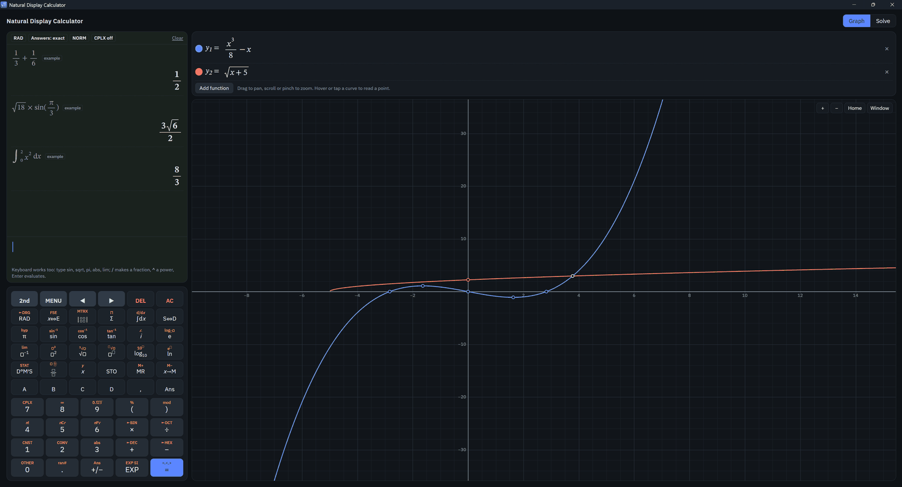

## What it does

- **Calculate:** type the way it's printed: fractions, roots, powers, logs, integrals, derivatives, sums,
  products and limits in proper notation. Answers stay exact (½, 3√6⁄2, π⁄4) or switch to decimals with
  S⇔D. Also complex numbers, base-N (binary, octal, hex), statistics, matrices, physical constants, unit
  conversions and memories. On a computer you can type with the keyboard too.
- **Graph:** up to six functions at once. Roots, turning points, intercepts and intersections are marked; tap or hover
  to read a point, drag to pan, pinch or scroll to zoom, or set the window exactly.
- **Solve, with worked steps:**
  - *Derivative:* any order, step by step through the power, product, quotient and chain rules.
  - *Integral:* indefinite or between limits, checked by differentiating the answer.
  - *Algebra:* solve equations and systems, simplify, expand and factor.
  - *Matrix:* determinant, inverse, transpose, row reduction, rank, eigenvalues, A + B, A − B, A·B and
    A·x = B, all in exact fractions.
  - *Geometry:* triangle solver and Pythagoras, isosceles triangle, circle, sector and arc, rectangle,
    regular polygon, sphere, cylinder, cone and cuboid, with a drawing.
- **Settings:** light, dark or match the system; degrees, radians or gradians; exact or decimal answers;
  normal, fixed, scientific or engineering format.

On a wide screen the calculator and the Graph or Solve tab sit side by side:

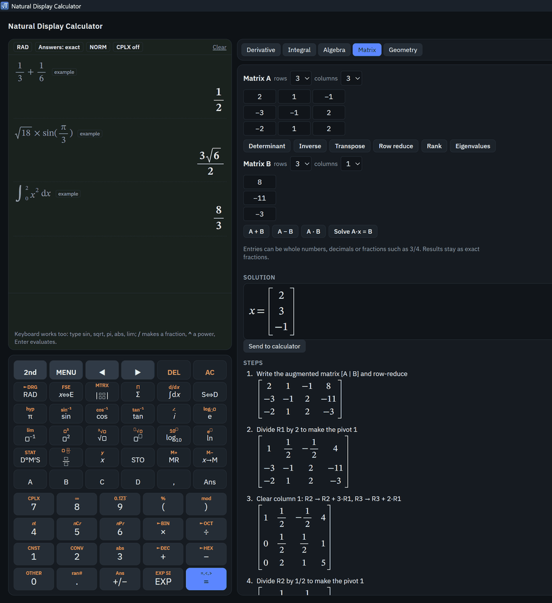

On a phone they share one screen, with Calculate, Graph and Solve tabs:

<table>
  <tr>
    <td valign="top">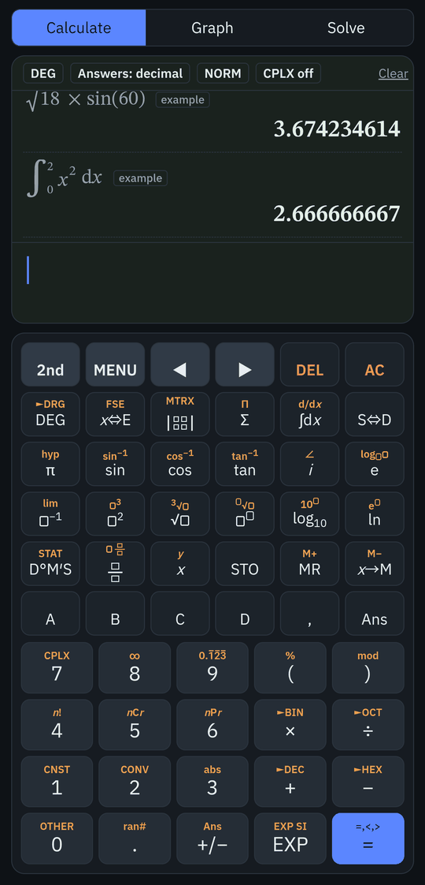</td>
    <td valign="top">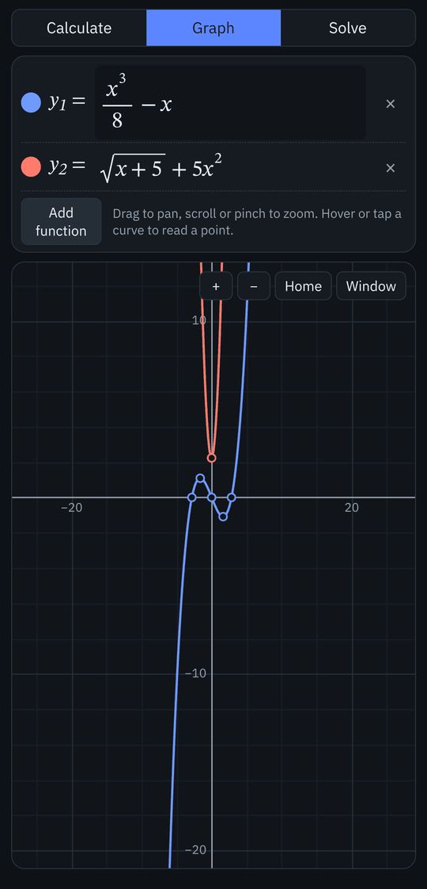</td>
    <td valign="top">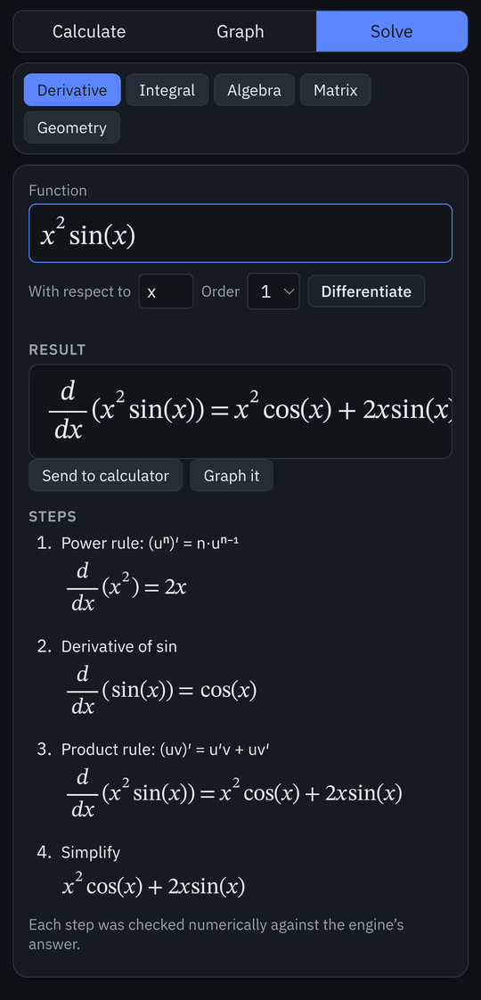</td>
  </tr>
  <tr>
    <td valign="top">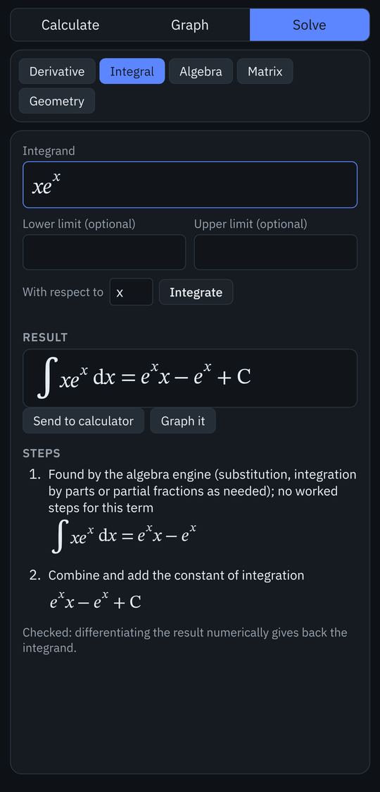</td>
    <td valign="top">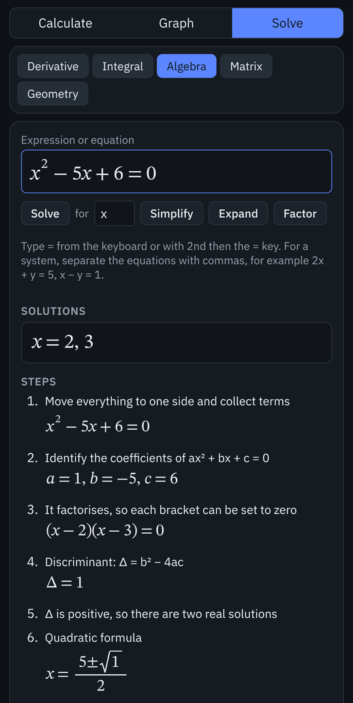</td>
    <td valign="top">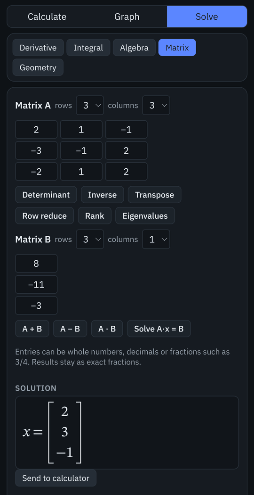</td>
  </tr>
  <tr>
    <td valign="top">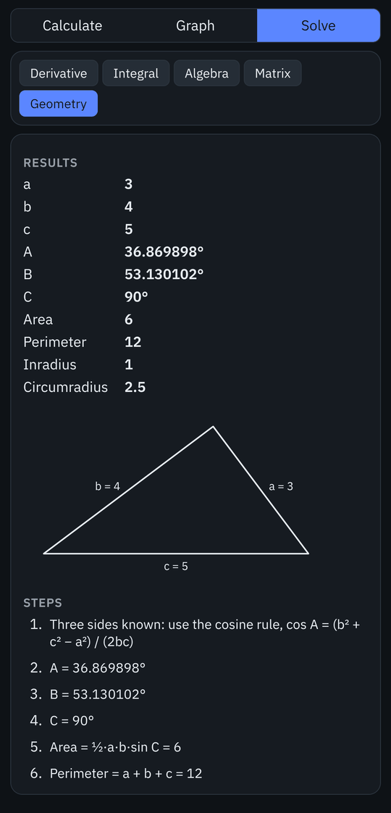</td>
    <td valign="top">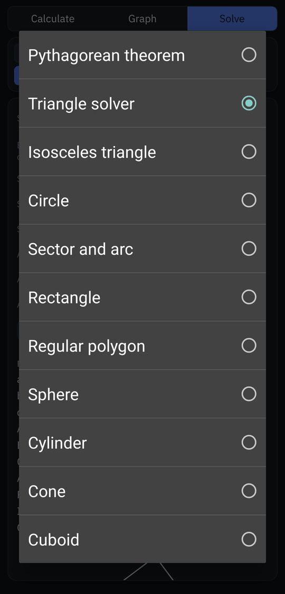</td>
    <td valign="top">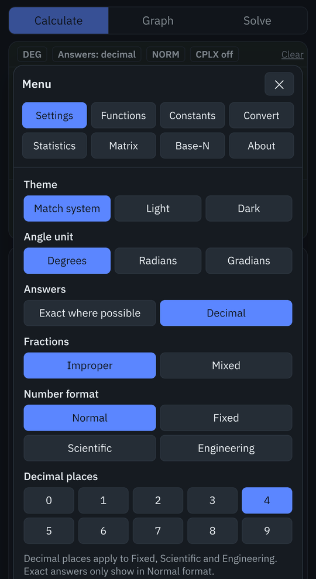</td>
  </tr>
</table>

## Download

Get the latest version from the [Releases page](../../releases/latest):

- **Windows 10 or 11:** `Natural-Display-Calculator-<version>-Windows-setup.exe` installs for the current user (no admin needed), adds a Start Menu entry and appears in Settings → Apps → Installed apps. Running a newer setup upgrades in place and keeps your settings; `/S` installs silently. The `Windows-portable.exe` runs without installing. Both use the WebView2 runtime, which Windows normally already has; the installer adds it if missing. See the note below about the warning Windows shows the first time.
- **Android 7.0 or newer:** `Natural-Display-Calculator-<version>-Android.apk`. Allow installs from your browser or file manager when prompted; Android may also warn that the app isn't from Google Play, which is expected. To update, install the new APK over the old one.
- **Any browser:** `Natural-Display-Calculator-<version>-offline.html` is the whole calculator in one file. Save it and open it; it works without a connection.

### The "Windows protected your PC" warning

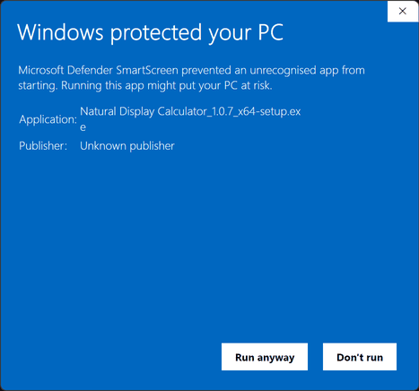

The first time you run the installer or the portable app, Microsoft Defender SmartScreen may stop it with
**Windows protected your PC** and **Publisher: Unknown publisher**. This doesn't mean a virus was found.
SmartScreen warns about any program that isn't code-signed and that it hasn't yet seen downloaded many times.
Code signing costs money every year, which this free hobby project doesn't pay for.

To run it, click **More info**, check the file name, then click **Run anyway**. You only need to do this once
for each file.

Only do this for files downloaded from this repository's [Releases page](../../releases/latest). If you got
the file anywhere else, delete it and download it from here instead.

<br clear="right">

## Privacy

The apps collect nothing and never connect to the internet: no analytics, no ads, no update checks. The Android app requests no permissions. Settings and graphs are stored only on your device. Links in the About tab open in your browser.

## Reporting bugs

Open an [issue](../../issues/new/choose). **MENU → About → Copy system info** copies your version, platform and settings to paste into the report. Security problems: see [SECURITY.md](SECURITY.md).

Pull requests are welcome. By submitting one you agree that your contribution is licensed under the same terms as the project (GPL-3.0-or-later).

## For maintainers

Every push to `main` builds all three apps; the latest set is also kept on the [`builds` branch](../../tree/builds). Pushes to `testing` build into the `test-builds` branch and never publish a release. To publish a release, change the number in `VERSION` (for example to `1.0.8`) and push to `main`; pushing a tag such as `v1.0.8` does the same.

### Repository layout

| Folder | What it is |
|---|---|
| `web/` | The calculator itself. `build.py` inlines the algebra library and fonts into one offline page, `web/dist/index.html`. |
| `windows/` | Windows desktop app. [Tauri](https://tauri.app) wrapper that renders the page with Microsoft Edge WebView2. |
| `android/` | Android app. A native `WebView` that serves the page from the app's own assets. No internet permission. |
| `art/` | App icon sources. |
| `docs/screenshots/` | Pictures used in this README. |

### Android signing

Updates only install over an existing copy if every APK is signed with the same key. The workflow reads it from these repository secrets:

| Secret | Value |
|---|---|
| `ANDROID_KEYSTORE_BASE64` | The release keystore (`.jks`), base64-encoded |
| `ANDROID_KEYSTORE_PASSWORD` | Keystore password |
| `ANDROID_KEY_ALIAS` | Key alias |
| `ANDROID_KEY_PASSWORD` | Key password |

Without them the build still succeeds but uses a throwaway debug key. Keep a backup of the keystore: if it is lost, the app has to be uninstalled before a newly signed version can be installed.

### Building locally

```sh
cd web && npm ci && python3 build.py          # web/dist/index.html
cd windows && npm ci && npx tauri build        # on Windows, with Rust installed
cd android && ./gradlew assembleRelease        # with the Android SDK (Android Studio)
```

To change the calculator, edit `web/src/index.html` or `web/src/solve.js`. Both apps pick up the rebuilt page.

## Licence

Copyright © 2026 Noel Chan

This program is free software: you can redistribute it and/or modify it under the terms of the GNU General Public License as published by the Free Software Foundation, either version 3 of the License, or (at your option) any later version. It is distributed in the hope that it will be useful, but WITHOUT ANY WARRANTY; without even the implied warranty of MERCHANTABILITY or FITNESS FOR A PARTICULAR PURPOSE. See [LICENSE](LICENSE) for the full text.

The bundled algebra library (MIT), fonts (SIL Open Font License 1.1), Android libraries (Apache 2.0) and Rust crates in the Windows app keep their own licences; see [THIRD-PARTY-NOTICES.md](THIRD-PARTY-NOTICES.md) and [licenses/](licenses/). After changing dependencies, regenerate the notices with `python3 tools/third_party_notices.py`. Each app shows the licence and notices under **MENU → About**.

The name "Natural Display" describes how the calculator shows maths; this project is not affiliated with or endorsed by Casio or any calculator maker.
